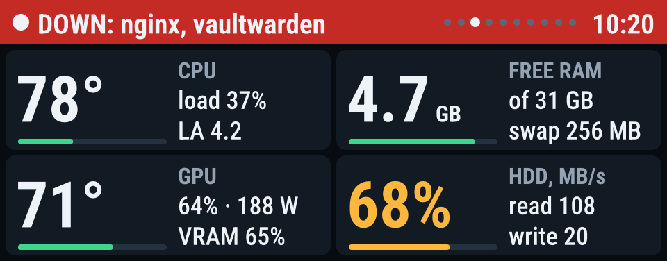
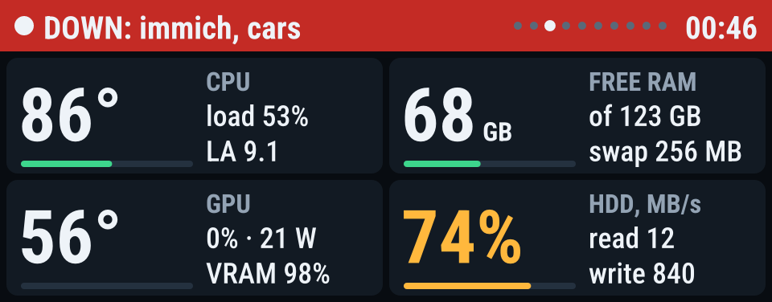
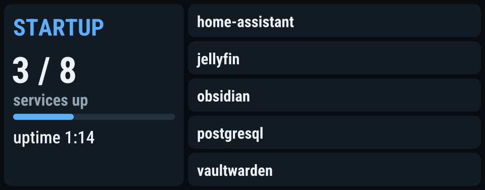
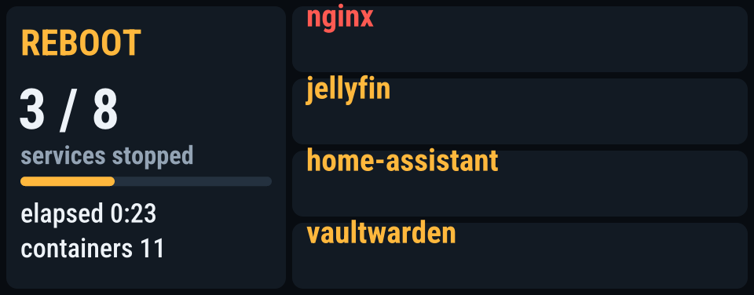
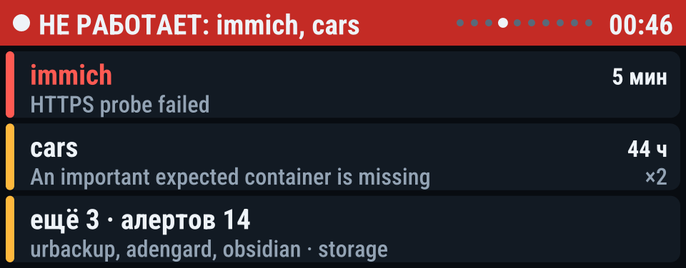
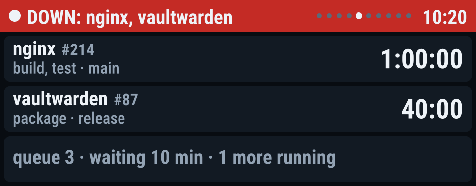
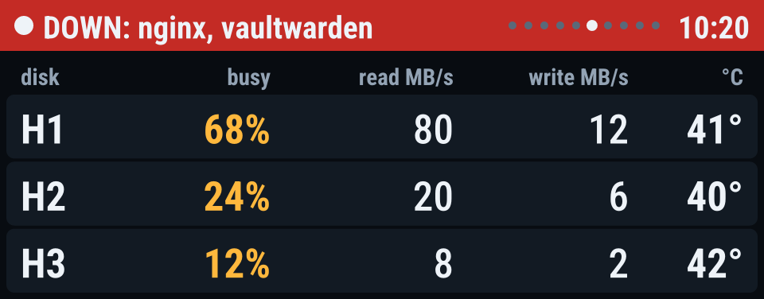
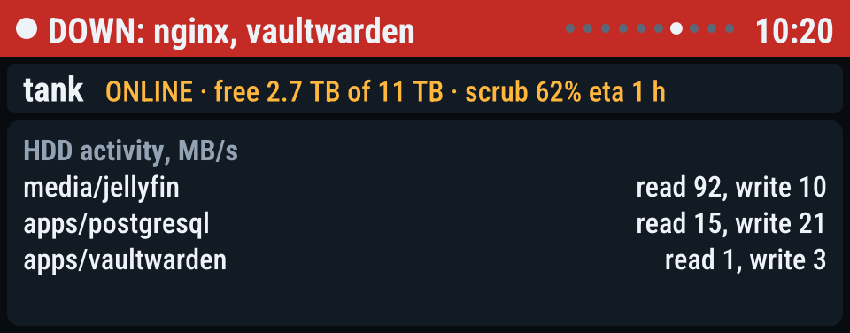

# aoostar-lcd

Status panel for the AOOSTAR WTR MAX front LCD (960×376, USB serial).



One systemd service renders every page: alarms, boot and shutdown progress,
disks, ZFS, Docker, CI. 10 languages built in, auto-detected from the system
locale.

| | | | |
|---|---|---|---|
|  |  |  |  |
|  |  |  |  |

## What you see

Pages rotate by relevance. The summary is always there; problems, CI and HDD
join only while relevant; a full-screen blinking **ALARM** takes over when a
configured disk/pool breaks or a critical service is down. On boot a
**STARTUP** page lists watched services that aren't up yet. On poweroff or
reboot, an `ExecStopPost` hook draws **SHUTDOWN / REBOOT** progress until
every watched service is down.

## Install

```sh
curl -fsSL https://raw.githubusercontent.com/nietonchique/aoostar-lcd/main/packaging/install.sh | sudo sh
```

Detects apt/dnf/pacman and installs the matching package; falls back to the
tarball. Or build from source:

```bash
cargo build --locked --release -p aoostar-lcd
sudo install -Dm755 target/release/aoostar-lcd /usr/local/bin/aoostar-lcd
sudo install -Dm644 config.example.toml /etc/aoostar-lcd.toml   # edit it
sudo install -Dm644 dist/aoostar-lcd.service /etc/systemd/system/
sudo systemctl daemon-reload && sudo systemctl enable --now aoostar-lcd
```

Available as [`aoostar-lcd-bin`](https://aur.archlinux.org/packages/aoostar-lcd-bin) on AUR,
plus `.deb` and `.rpm` on the [releases page](https://github.com/nietonchique/aoostar-lcd/releases).

## Languages

`i18n/en.toml`, `ru.toml`, `uk.toml`, `pl.toml`, `de.toml`, `fr.toml`,
`es.toml`, `tr.toml`, `zh.toml`, `ko.toml` — embedded in the binary.
`[display] language = "auto"` (the default) picks from the system locale and
falls back to English. Add or override any language by dropping a TOML file
into `[display] i18n_dir` — no rebuild needed. CJK text renders via subset
Noto Sans SC/KR fonts.

## Docs

- **[Where the data comes from](docs/data-sources.md)** — 11 read-only
  sources, what each reads, at what interval, how failures degrade.
- **[Configuration](docs/configuration.md)** — every section and key.
- **[Boot and power transitions](docs/boot-shutdown.md)** — why the unit is
  wired the way it is.
- **[Release runbook](packaging/README.md)** — how to cut a version, tag,
  update AUR.

## CLI

`run` drives the panel · `check` validates config without touching it ·
`snapshot` prints JSON · `preview` renders pages to PNG from a fixture ·
`shutdown` tracks poweroff/reboot progress · `off` blanks the panel.

## Development

```bash
cargo fmt --all --check
cargo clippy --workspace --all-targets -- -D warnings
cargo test --workspace

# Offline preview of every page
cargo run -p aoostar-lcd -- preview --config config.example.toml \
  --fixture crates/aoostar-lcd/fixtures/busy.json --out-dir /tmp/lcd
```

Layout regressions are caught by pixel-level tests that render pages and
measure the actual PNG output (ink symmetry, card spacing, meter insets).

## License

MIT OR Apache-2.0. Roboto Condensed and Noto Sans subsets under SIL OFL.
Serial protocol from [zehnm/aoostar-rs](https://github.com/zehnm/aoostar-rs).
