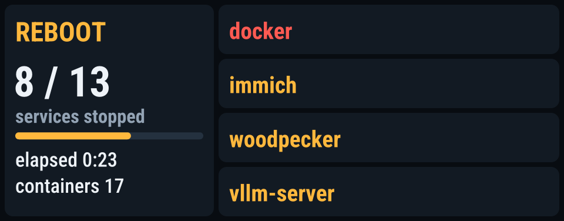

# aoostar-lcd

Статус-панель для переднего LCD сервера AOOSTAR WTR MAX (960×376, USB
serial). Один systemd-сервис рисует все экраны: аварии, прогресс загрузки и
выключения, диски, ZFS, Docker, CI. Язык интерфейса: русский или английский.

| | | | |
|---|---|---|---|
|  |  |  |  |
|  |  |  |  |

Страницы ротируются по релевантности: сводка видна всегда; проблемы, CI и
HDD подключаются только когда уместны; полноэкранная мигающая **АВАРИЯ**
перекрывает всё, если сломан настроенный диск/пул или лежит критичный
сервис. При загрузке страница **ЗАПУСК** перечисляет ещё не поднятые сервисы
(и глушит сервисные тревоги, пока видна); при выключении/перезагрузке хук
`ExecStopPost` рисует прогресс **ВЫКЛЮЧЕНИЕ / ПЕРЕЗАГРУЗКА**, пока не
остановится всё наблюдаемое. Скриншоты выше — русский UI
(`[display] language = "ru"`).

## Откуда берутся данные

Только локальное состояние «по чтению» плюс два опциональных скрейпера.
На панель уходят лишь пиксели; наружу с хоста — ничего.

| Источник | Что читает | Каждые | Питает |
|---|---|---|---|
| `/proc` | `stat`, `loadavg`, `meminfo`, `uptime`, `diskstats`, `mountinfo` | 1 с | нагрузка CPU, ОЗУ/swap, чтение/запись/IOPS/busy дисков, место на томах |
| `/sys/class/hwmon` | датчики температур и вентиляторов | 1 с | температуры CPU/GPU/ОЗУ, обороты |
| дерево cgroup v2 | CPU и память по cgroup | 2 с | «топ ворклоадов» (контейнеры, сервисы) |
| `/proc/spl/kstat/zfs/<pool>/objset-*` | счётчики логического I/O датасетов | 1 с | самые нагруженные датасеты — кто нагружает HDD |
| Docker Engine API | `/containers/json` через `/run/docker.sock`; `CI_*` env шагов Woodpecker | 5 с | нездоровые/перезапускающиеся контейнеры, идущие CI-пайплайны |
| `systemctl` | `list-units` + `show` настроенных стеков/юнитов; `list-jobs` | 5 с / при остановке | простои сервисов, failed-юниты, флаги обслуживания, выключение-vs-перезагрузка |
| `nvidia-smi` | утилизация, температура, питание, VRAM | 5 с | плитка GPU |
| `zpool status -j`, `zpool list` | здоровье пулов и листов, ёмкость, скан | 30 с | страница ZFS, аварии по пулам |
| `smartctl -j -H -c -A` | вердикт здоровья, температура, прогресс самотеста | 60 с | плитки HDD, аварии по дискам |
| Grafana alert API *(опционально)* | горящие алерты по HTTP с Viewer-токеном | 15 с | дополнительные проблемы; `outage_families` эскалируют до АВАРИИ |
| Prometheus *(опционально)* | метрики очереди Woodpecker | 30 с | длина очереди и ожидание CI |

Упавший источник держит последнее значение три интервала, затем показывает
`--`; недоступный Grafana сам становится строкой в проблемах.

## Конфигурация

Один TOML-файл (`/etc/aoostar-lcd.toml`); [`config.example.toml`](config.example.toml)
документирует каждый ключ.

| Секция | Ключи | Смысл |
|---|---|---|
| `[display]` | `device`, `language` (`en`/`ru`), `page_seconds`, `heartbeat`, `clock_utc_offset_minutes` | устройство панели, язык UI, скорость ротации, сдвиг часов |
| `[thresholds]` | `*_temp_c`, `memory_used_percent`, `space_used_percent`, `hdd_busy_percent`, `ci_minutes` — каждые `[warning, critical]` | когда значения желтеют/краснеют и какие страницы входят в ротацию |
| `[[disk]]` | `label` (1–4 знака), `kind` (`nvme`/`hdd`), `by_id` | наблюдаемые диски; **только by-id**; пропажа или SMART-отказ → АВАРИЯ |
| `[[volume]]` | `label`, `path` | файловые системы на странице «Место» |
| `[zfs]` | `pools` (первый — основной) | наблюдаемые пулы; лист не `ONLINE` → АВАРИЯ |
| `[services]` | `templates`, `units`, `startup_window_secs`, `maintenance_dir`, `docker_socket` | systemd-юниты, которые должны быть активны; `<dir>/<юнит>` или `<dir>/ALL` = намеренная остановка; длина окна загрузки |
| `[alerts]` *(опционально)* | `grafana_url`, `grafana_host`, `token_file`, `local_node`, `outage_families` | интеграция с алертами Grafana |
| `[ci]` *(опционально)* | `prometheus_url` | метрики очереди Woodpecker |

Загрузка и выключение: юнит упорядочен только за локальными ФС и serial-устройством
панели — никогда за Docker, поэтому ЗАПУСК появляется так рано, как позволяет
железо; при остановке сервис гаснет в первой волне, удерживая страницу
прогресса до 80 с (внутри 90-секундного бюджета systemd), пока стеки
останавливаются параллельно. Если выключения нет — хук просто гасит панель;
poweroff завершается тёмным экраном, после перезагрузки последний кадр держится
до страницы ЗАПУСК.

## Установка

Linux + systemd, Rust 1.88+, `libudev-dev`, `pkg-config`.

```bash
cargo build --locked --release -p aoostar-lcd
sudo install -Dm0755 target/release/aoostar-lcd /usr/local/bin/aoostar-lcd
sudo install -Dm0644 config.example.toml /etc/aoostar-lcd.toml   # отредактировать
sudo install -Dm0644 dist/aoostar-lcd.service /etc/systemd/system/
sudo systemctl daemon-reload && sudo systemctl enable --now aoostar-lcd
```

CLI: `run`, `check` (проверка конфига без записи в панель), `snapshot`
(JSON), `preview` (рендер страниц в PNG из снапшота), `shutdown`, `off`.

## Лицензия

MIT OR Apache-2.0; Roboto Condensed — SIL OFL. Протокол панели — из
[zehnm/aoostar-rs](https://github.com/zehnm/aoostar-rs).
[English version](README.md).
